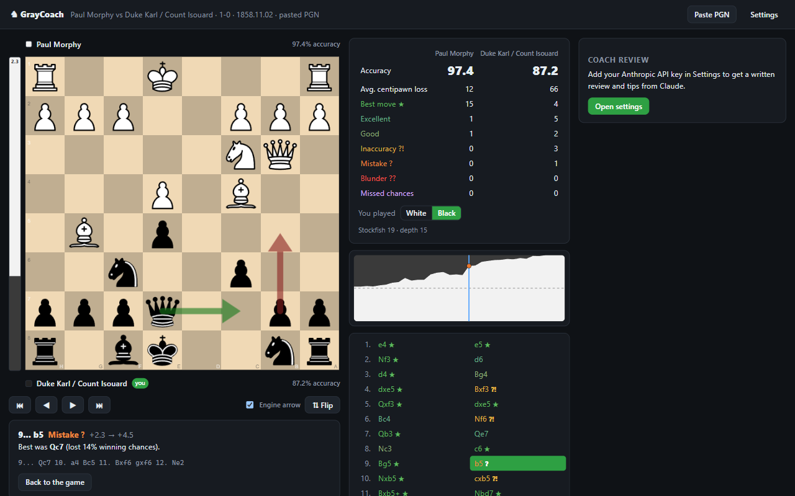

# GrayCoach

A Chrome/Edge extension that reviews your **finished** chess.com and Lichess games:

- **Stockfish 19** runs in your browser and grades every move (best, excellent, good, inaccuracy, mistake, blunder, missed chance), with accuracy, average centipawn loss and an eval graph.
- **Claude** reads the engine report and writes a coach review: what decided the game, 3–6 key moments, strengths, weaknesses, tips and one thing to train next.
- **Ask the coach** questions about any position while you click through the game.
- **Click any move the coach names** to jump the board there. Moves it suggests (that weren't played) show as a green arrow.
- Reviews open in the browser's **side panel**, right next to the game. Prefer a full tab? Change it in Settings, or click **Open in tab ↗**.



## Install

### Download (no build needed)

1. Download `graycoach-vX.Y.Z.zip` from the [latest release](https://github.com/gislost/GrayCoach/releases/latest) and unzip it to a folder you'll keep.
2. Open `chrome://extensions` (or `edge://extensions` in Edge).
3. Turn on **Developer mode**.
4. Click **Load unpacked** and pick the unzipped folder (the one with `manifest.json` in it).
5. Pin the extension, open its **Settings** and add your chess.com and Lichess usernames. For the coach review, either press **Connect Gray Hub** to use your Gray Hub account's Claude (counts toward its daily AI limit; the admin turns on GrayCoach for your account), or paste an Anthropic API key from [console.anthropic.com](https://console.anthropic.com/settings/keys). Without either you still get the full Stockfish review.

### Updating

Browsers don't update extensions loaded this way, so GrayCoach checks GitHub once a day and puts **NEW** on its toolbar icon when a newer version is out. The popup and the review page link to the steps, which are also in Settings → **Updates**:

1. Download the new zip from the [latest release](https://github.com/gislost/GrayCoach/releases/latest).
2. Unzip it and copy everything inside into your GrayCoach folder (the one you picked with **Load unpacked**), replacing the old files.
3. Click **Reload GrayCoach** in Settings → Updates, or the reload button ↻ on the extension card. Then refresh any open chess.com or Lichess tabs.

Your settings, API key and saved reviews stay. Don't click **Remove** on the extension card: that deletes them. The daily check can be turned off in Settings → Updates.

**Coming from 1.0 or 1.1 (one time only):** older versions got a new extension ID whenever they were loaded from a different folder, and the browser keeps settings per ID. From 1.2.0 the ID is fixed (the `key` in `manifest.json`), so to move over: **Remove** the old GrayCoach, **Load unpacked** the 1.2.0 folder, and enter your API key and usernames one last time. After that, updates keep them.

### Build from source

Needs Node 20 or newer.

```bash
npm install
npm run build
```

Then load the `dist` folder with **Load unpacked** as above. `npm run watch` rebuilds as you edit (press reload on the extension card after a change). `npm run package` builds and writes the release zip to `release/`.

## Use it

- Finish a game on chess.com or Lichess, then click the green **♞ Coach review** button (bottom right), or use the toolbar popup → **Review this game**.
- The popup also has **Latest chess.com game**, **Latest Lichess game** (from your usernames) and **Paste a PGN**.
- In the review: ← → step through moves, **F** flips the board, click the graph, a key moment or a move in the coach's text to jump, and **Show the better move** shows what the engine wanted.
- The review opens in the side panel next to the game. Settings → **Where reviews open** switches to a new tab instead. Pasted PGNs always open in a tab.

Analyses and coach reviews for your last 40 games are saved locally, so they reopen instantly.

## Privacy and cost

- The API key is kept in the extension's local storage and is sent only to `api.anthropic.com`.
- When Gray Hub is connected, the coach requests (the game report and your questions) go to `dojo.grayhub.dev`, which passes them to Claude. The connection token is kept in the extension's local storage; Disconnect in Settings revokes it.
- Stockfish runs locally. Only the coach step sends the moves and engine report to Claude.
- Each coach review is one API call on your key. Follow-up questions are one call each. Pick the model in Settings.
- Once a day the extension asks GitHub's public API for the latest release number. Nothing about you is sent, and Settings → Updates turns it off.
- No analytics or tracking. The full policy is in [PRIVACY.md](PRIVACY.md).

## Fair play

The extension only reviews games that are over. It refuses unfinished chess.com and Lichess games, and pasted PGNs without a result need an explicit "this game is over" tick. Using engine help during a game you're playing breaks the rules on both sites.

## Licenses

GrayCoach is free software under the [GNU GPL v3 or later](LICENSE). It bundles:

- [Stockfish](https://stockfishchess.org) 19 lite (via the `stockfish` npm package): GPL-3.0. Its license ships in the build as `engine/COPYING.txt`.
- [chessground](https://github.com/lichess-org/chessground): GPL-3.0-or-later. The cburnett piece set is CC BY-SA 3.0.
- [chess.js](https://github.com/jhlywa/chess.js): BSD-2-Clause.
- [Anthropic TypeScript SDK](https://github.com/anthropics/anthropic-sdk-typescript): Apache-2.0. [zod](https://zod.dev): MIT.

The build includes `THIRD_PARTY_LICENSES.txt` with the license text of every bundled package.

Not affiliated with chess.com, Lichess or Anthropic.
